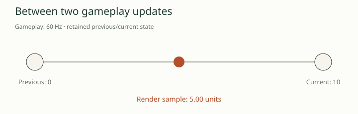

# 04 · Understanding the frame-rate goal

> Prefer the illustrated reader? [Read this chapter in the Wiki](../../.local/wiki/04-frame-rate.html).

> **At a glance**
>
> - **Question:** Can we show smoother motion without making the game run too fast?
> - **Result:** Keep gameplay at 60 updates per second and draw intermediate poses. Simply increasing the video clock accelerated the game.
> - **Still open:** Rendering 120 images does not prove a screen displayed them. Normal-speed 144 Hz and 120-Hz gameplay simulation remain unproven.

The first high-refresh experiment made the game run faster, not correctly. The later prototype took a different route: retain 60 gameplay updates per emulated second, but render intermediate model and camera poses more often. This distinction explains both the progress and the remaining gap between a counter showing 120 and a phone displaying smooth, normal-speed play.

This chapter summarizes retained experiments, reviewed on 2026-10-25. The compact evidence records are [R01–R03](../evidence/rendering-findings.json); no game benchmark was rerun while writing this report.

## Read the five frame-rate measurements

| Measurement | What it establishes | What it does not establish |
| --- | --- | --- |
| Virtual video rate | How frequently the guest receives scheduled video intervals | Correct gameplay speed |
| Gameplay updates | How frequently movement, combat and timers advance | How many images reach the screen |
| Computed render updates | How many rendering iterations finish | Unique image content or physical display delivery |
| Browser “shown” cadence | Browser callbacks with newly completed presentations | Direct measurement of screen scanout |
| Physical display refresh | The screen's refresh capability | That the game supplies a distinct image for each refresh |

Audio adds another independent clock. The existing EE clock is 294,912,000 cycles per emulated second; the IOP runs at EE/8, and the SPU2 path produces 48,000 stereo sample frames per emulated second. Producing only 24,000 sample frames per wall second means the game is falling behind even if a video counter looks high. Generated audio duration also cannot prove that a device played it without underruns.

“Emulated second” and “wall second” must remain separate. An offline run can correctly generate 120 frames for one emulated second while taking two real seconds to do so. A high-refresh display is then irrelevant to the immediate throughput problem.

## Experiment 1: increase the video clock

The rate-only probe loaded the same saved battle and changed video scheduling to 60, 120 or 144 Hz while retaining the EE/IOP clocks and audio sample rate. It excluded the inherited first interval from measurement. Each row below covers five **emulated** seconds, not a five-second real-time performance claim.

| Video target | Battle updates | Countdown ticks | Countdown seconds | Produced audio frames |
| ---: | ---: | ---: | ---: | ---: |
| 60 Hz | 300 | 300 | 5 | 240,000 |
| 120 Hz | 600 | 600 | 10 | 240,000 |
| 144 Hz | 720 | 720 | 12 | 240,000 |
| 120 Hz, countdown-only control | 600 | 300 | 5 | 240,000 |
| 144 Hz, countdown-only control | 720 | 300 | 5 | 240,000 |

The countdown-only control was a diagnostic intervention. It did not become a playable patch. At the higher rates, actor positions still matched the corresponding accelerated run despite the corrected countdown. In the movement comparison, one second at 120 Hz reached the same positions as two seconds at 60 Hz; one second at 144 Hz matched 2.4 seconds at 60 Hz. The game advances substantial behavior once per update rather than through a universal elapsed-time parameter recovered by this investigation.

Simply replacing timer constants would also be incomplete. The original match clock is a signed 16-bit field: 300 seconds multiplied by 144 would require 43,200 ticks, beyond its positive range. Expiry, exact event thresholds and initialization all matter. A timer that looks right is weak evidence when movement, damage, animation and AI have not been checked.

## Experiment 2: render without advancing gameplay

The next prototype used an existing branch that bypasses the mode update while retaining drawing callbacks. At 120 video intervals, it ran canonical gameplay on one interval and additional rendering on the other. This corrected the update cadence, but initially drew almost the same state twice: a two-second moving sequence contained 241 captures, including its initial observation, with only 122 distinct images.

Interpolation changed the rendering copies of model transforms and the camera between their previous and current canonical states. The same sequence then contained 241 distinct image hashes while its tracked simulation state continued to match the 60-Hz reference. This is evidence of new visual samples in that captured scene, not merely repeated framebuffers.

At 60 gameplay updates and 120 render updates, input, collisions and combat decisions still advance at 60. The additional image is an intermediate view of motion between retained states. The implemented history-based method introduces approximately one simulation tick, 16.7 ms, of presentation delay. It therefore trades some visual latency for smoother motion; it does not promise twice the input responsiveness.

<!-- interactive: render-clock -->

## Two research routes, with different costs

| Route | Current result | Remaining work |
| --- | --- | --- |
| Keep gameplay at 60; interpolate extra renders | Implemented and tested in bounded battle paths | Physical high-refresh presentation, more effects and modes, sustained phone throughput |
| Run gameplay at 120/144 with smaller timesteps | Not implemented | Recover and retime movement, acceleration, collision, animation, AI, input, cooldowns and scheduler behavior |

The adaptive implementation is bounded to 60–120 video Hz. Normal-speed 144 rendering has not been demonstrated. Its fractional relationship to 60-Hz simulation requires correct phase handling, and the available render budget shrinks from 8.33 ms at 120 to 6.94 ms at 144. Raising a constant would not establish that either the behavior or the hardware meets that budget.

## How to prove that higher refresh works

A defensible result needs normal-speed gameplay, correct controls and transitions, stable audio production and consumption, distinct rendered motion, and measured display delivery on the intended device. These are separate checks. The latest PC result supports approximately 120 computed render updates at normal game speed in a narrow Versus scene. Its desktop exposed 60 Hz and reported about 56 shown updates per second. It cannot establish physical 120-Hz delivery or the performance of the latest build on a phone.

The next chapters explain the recovered rendering boundary and how continuous cadence, input-edge preservation and mode guards turned the initial experiment into a more usable candidate.

Source trail and verification records

[R01–R03 in the curated evidence file](../evidence/rendering-findings.json) identify the original working-tree sources, their SHA-256 hashes, and the selected measurements. The principal source reports are `docs/gundam-high-fps-research.md` and `docs/gundam-120fps-prototype.md` in the original `ps2-web-recomp` working tree. Raw RAM, save states and image captures remain outside this report repository.

