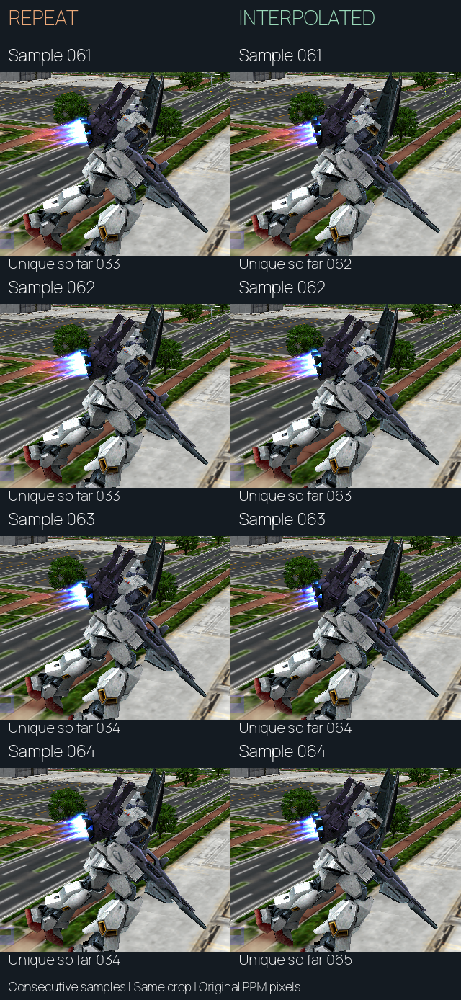

# 04 · Understanding the frame-rate goal

> Prefer the illustrated reader? [Read this chapter in the Wiki](https://sennett-lau.github.io/re-gvs-gvzg/04-frame-rate.html).

> **At a glance**
>
> - **Question:** Can we show smoother motion without making the game run too fast?
> - **Result:** Keep gameplay at 60 updates per second and draw intermediate poses. Simply increasing the video clock accelerated the game.
> - **Still open:** Broader game-mode and current-phone coverage are follow-up work. The above-60 rendering proof of concept is established.

The first high-refresh experiment made the game run faster, not correctly. The later prototype retains 60 gameplay updates per emulated second, but renders intermediate model and camera poses more often.

**The goal is to demonstrate normal-speed rendering beyond the original 60-update rate.** The [measured 120-render PC result](06-adaptive-rendering.md#the-latest-paired-pc-result) meets that goal. Perfectly constant frame spacing is not required for this proof of concept. Its measured variation remains part of the evidence. Further 144-Hz testing is outside the current scope.

**✅ Verified · Native timing and image comparisons.** See [R01–R03](../evidence/rendering-findings.json) for the retained controls.

## Read the five frame-rate measurements

| Measurement | What it establishes | What it does not establish |
| --- | --- | --- |
| Virtual video rate | How frequently the guest receives scheduled video intervals | Correct gameplay speed |
| Gameplay updates | How frequently movement, combat and timers advance | How many images reach the screen |
| Computed render updates | How many rendering iterations finish | Unique image content or physical display delivery |
| Browser “shown” cadence | Browser callbacks with newly completed presentations | Direct measurement of screen scanout |
| Physical display refresh | The screen's refresh capability | That the game supplies a distinct image for each refresh |

Audio adds another independent clock. The EE clock runs at 294,912,000 cycles per emulated second. The IOP runs at EE/8. The SPU2 audio path produces 48,000 stereo sample frames per emulated second. Producing only 24,000 sample frames per wall second means the game is falling behind even if a video counter looks high. Generated audio duration also cannot prove that a device played it without underruns.

“Emulated second” and “wall second” must remain separate. An offline run can correctly generate 120 frames for one emulated second while taking two real seconds to do so. A high-refresh display is then irrelevant to the immediate throughput problem.

## Experiment 1: increase the video clock

The rate-only probe loaded the same saved battle and scheduled video at 60, 120 or 144 Hz. The EE/IOP clocks and audio sample rate stayed unchanged. It excluded the inherited first interval from measurement. Each row below covers five **emulated** seconds, not a five-second real-time performance claim.

| Video target | Battle updates | Countdown ticks | Countdown seconds | Produced audio frames |
| ---: | ---: | ---: | ---: | ---: |
| 60 Hz | 300 | 300 | 5 | 240,000 |
| 120 Hz | 600 | 600 | 10 | 240,000 |
| 144 Hz | 720 | 720 | 12 | 240,000 |
| 120 Hz, countdown-only control | 600 | 300 | 5 | 240,000 |
| 144 Hz, countdown-only control | 720 | 300 | 5 | 240,000 |

The countdown-only control was a diagnostic intervention. It did not become a playable patch. At the higher rates, actor positions still matched the corresponding accelerated run despite the corrected countdown. In the movement comparison, one second at 120 Hz reached the same positions as two seconds at 60 Hz. One second at 144 Hz matched 2.4 seconds at 60 Hz. The game advances substantial behavior once per update rather than through a universal elapsed-time parameter recovered by this investigation.

Simply replacing timer constants would also be incomplete. The original match clock is a signed 16-bit field: 300 seconds multiplied by 144 would require 43,200 ticks, beyond its positive range. Expiry, exact event thresholds and initialization all matter. A timer that looks right is weak evidence when movement, damage, animation and AI have not been checked.

## Experiment 2: render without advancing gameplay

The next prototype used an existing branch that bypasses the mode update while retaining drawing callbacks. At 120 video intervals, it ran canonical gameplay on one interval and additional rendering on the other. Here, canonical state means the gameplay state at a regular 60-Hz update. This corrected the update cadence but initially drew almost the same state twice. A two-second moving sequence contained 241 captures, including its initial observation. Only 122 images were distinct.

Interpolation changed the rendering copies of model transforms and the camera between their previous and current canonical states. The same sequence then contained 241 distinct image hashes while its tracked simulation state continued to match the 60-Hz reference. This is evidence of new visual samples in that captured scene, not merely repeated framebuffers.

<video controls muted playsinline preload="none" poster="../media/repeat-vs-interpolate-poster.png" aria-label="Four-times slower comparison: repeated frames on the left, interpolation on the right" src="../media/repeat-vs-interpolate-quarter-speed.mp4"></video>

*Left: repeat control. Right: interpolated motion. Burned labels identify each sample and the cumulative number of unique source images. Playback is four times slower: 120 samples per emulated second play at 30 FPS. This is an offline image comparison.*

*Read down each column. Samples 61–62 repeat one image on the left; 63–64 repeat the next. All four right-hand samples differ. Every cell uses the same unscaled crop; counts refer to complete original images, starting at sample 0.*

[Download the labeled video](../media/repeat-vs-interpolate-quarter-speed.mp4) · [Open the filmstrip](../media/repeat-vs-interpolate-filmstrip.png) · [Capture provenance](../evidence/review-provenance.json)

> [!IMPORTANT]
> **120 render updates can retain 60 gameplay updates.**
>
> Input, collisions and combat decisions still advance at 60. The additional image shows an intermediate pose between retained states.
>
> The implemented method adds approximately **16.7 ms** of presentation delay, or one simulation tick. It produces smoother motion at the cost of some visual delay. Input responsiveness does not double.

## Two research routes, with different costs

| Route | Current result | Remaining work |
| --- | --- | --- |
| Keep gameplay at 60 and interpolate extra renders | Above-60 proof of concept established, including PC OS display evidence at about 120/s | Optional extension to more effects, modes and sustained phone use |
| Run gameplay itself above 60 with smaller timesteps | Not implemented; separate research direction | Recover and retime movement, acceleration, collision, animation, AI, input, cooldowns and scheduler behavior |

The adaptive implementation is bounded to 60–120 video Hz. The 144-Hz values in Experiment 1 document the earlier accelerated-game diagnostic. They are not an implemented normal-speed mode or a required next milestone.

## How to prove that higher refresh works

A defensible result needs separate checks on the intended device:

- Normal-speed gameplay, correct controls and correct transitions.
- Stable audio production and consumption.
- Distinct rendered motion.
- Measured display delivery.

The [paired PC result](06-adaptive-rendering.md#the-latest-paired-pc-result) supplies normal-speed counters and OS display delivery. The native comparison above supplies distinct intermediate-image evidence. Together they support the scoped proof of concept; extending device and mode coverage is separate work.

The next chapters explain the recovered rendering boundary. They cover continuous timing, button-press detection and the conditions that permit extra rendering.

Source trail and verification records

[R01–R03 in the curated evidence file](../evidence/rendering-findings.json) identify the original working-tree sources, their SHA-256 hashes, and the selected measurements. The principal source reports are `docs/gundam-high-fps-research.md` and `docs/gundam-120fps-prototype.md` in the original `ps2-web-recomp` working tree. Selected visuals appear in Experiment 2. Raw RAM and save states remain outside this report repository.

