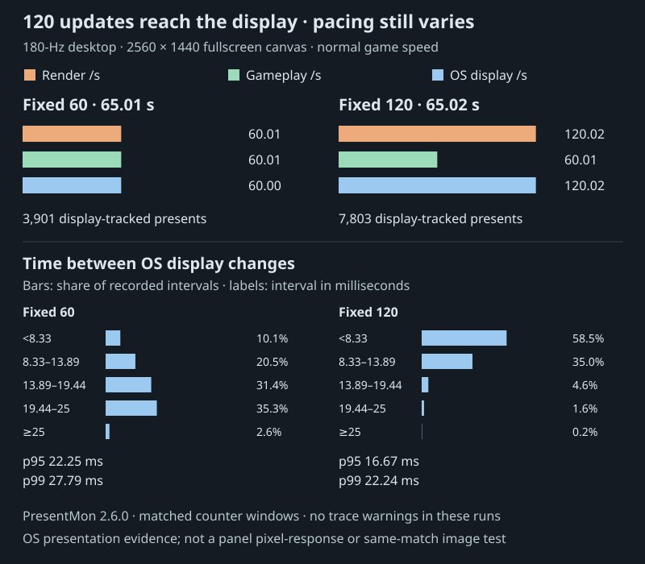
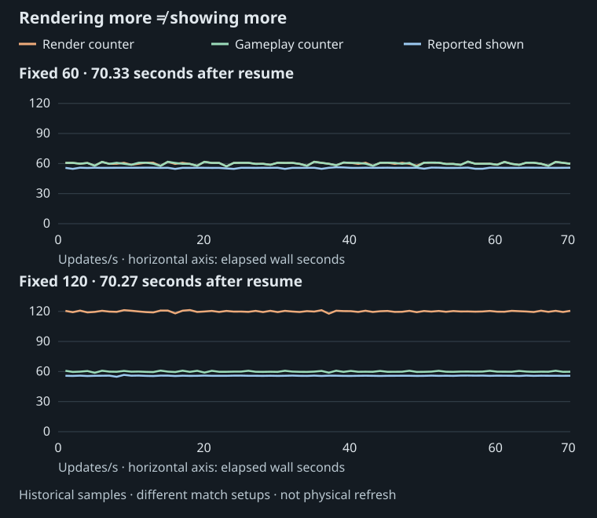
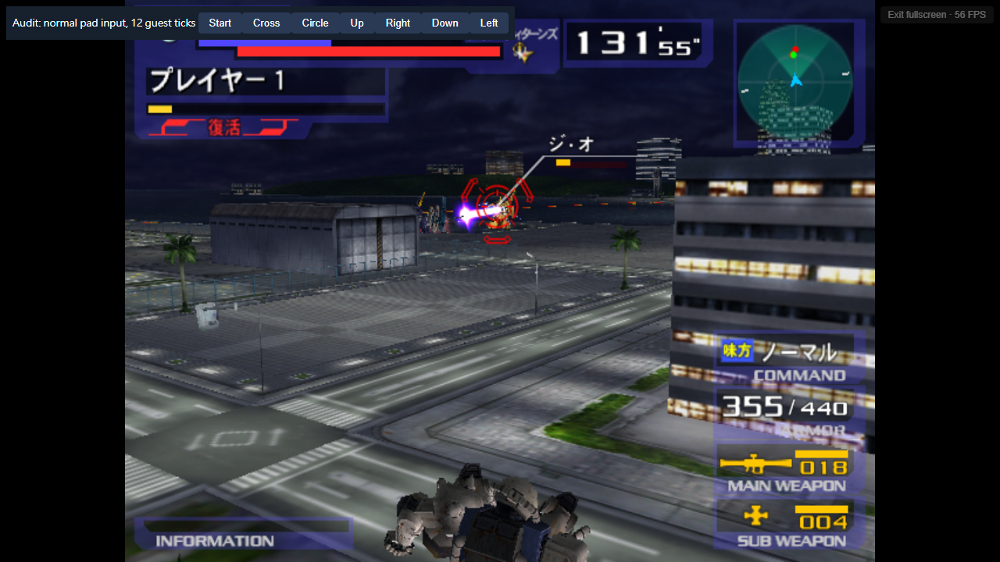

# 06 · Adaptive rendering: results and limits

> Prefer the illustrated reader? [Read this chapter in the Wiki](../../.local/wiki/06-adaptive-rendering.html).

> **At a glance**
>
> - **Question:** Can the amount of extra rendering adapt to the device’s available time?
> - **Result:** The latest PC run reached 120.02 renders and OS display updates/s, with 60.01 gameplay updates/s on a confirmed 180-Hz desktop.
> - **Still open:** Frame pacing varies. Current-build phone measurements and complete match flows still need validation.

**Adaptive rendering adjusts the drawing workload while keeping gameplay at 60 updates per emulated second.** The early fixed-120 schedule advanced gameplay on every second render interval. If a device completed only 80 intervals per wall second, gameplay fell to 40 updates and audio slowed down. At a correctly scheduled target of 80, those 80 intervals can contain all 60 gameplay updates.

**🟡 Partially verified · Normal-speed rendering works in tested scenes.** Extra rendering cannot help a device that already misses the original 60-update workload. The phone's slow main menu remains a separate problem.

## Keep game time continuous as the target changes

The native controller accumulates the **previously scheduled** video interval in EE cycles. It derives a canonical tick at 60 Hz. Once per VBlank, it stores the next requested rate. A repeated canonical tick marks an extra rendering interval. The fractional remainder determines interpolation between retained poses.

Changing the target does not reset this fraction. Resetting it could add or remove game time or visibly jump a pose. Even a return to 60 can retain a fractional offset, so interpolation history cannot always be bypassed just because the current target is 60. Scene changes reset pose history while the time accumulator remains continuous.

Fixed native tests at 80, 90, 100 and 120 produced 120 logic ticks and 96,000 audio frames over two emulated seconds. Tracked canonical fields matched the reference, with distinct captured images.

A longer controlled run made 45 rate changes over 30 emulated seconds. It included pause, resume and observed death/respawn. All 2,296 candidate observations matched, with 1,800 logical updates.

These comparisons used matched game-facing input-cache replay. A separate strict comparison with ordinary asynchronous input failed. They are not proof of network determinism across adaptive clients. [R03](../evidence/rendering-findings.json)

The implementation accepts 60–120. The policy selects 60, 72, 80, 90, 100, 110 or 120. Integer cycle division gives some rates a small timing approximation. Long-duration drift at arbitrary integer requests remains a timing test.

## Adapt the target and give the browser time to paint

The browser policy samples guest speed, completed video work, audio queue health and software timing estimates. Two sustained slow samples can reduce the target. Five healthy samples can trigger a trial at the next higher step, followed by a settling period. Invalid, hidden or transitional windows do not justify an increase. This hysteresis avoids chasing every brief fluctuation.

A second problem was browser scheduling. Resolving a suspended WASM continuation inside `requestAnimationFrame` can resume work before the browser paints. The bounded presentation scheduler yields into a later task and limits bursts. A later correction permits one additional presentation slot for a small accumulated cadence deficit near the calibrated display cadence. It does not change gameplay or audio clocks, and it is not permission to run unlimited catch-up work when the browser is overloaded.

In the same-package PC comparison, this allowance increased the computed rate from 112.43 to 120.03 updates per wall second. Gameplay increased from 56.21 to 60.01 ticks per wall second. The measured window used 224 extra presentation slots and no new timer fallback. Shown cadence stayed around 56. The cadence-only candidate was nevertheless withheld after the missed-Start test described in Chapter 05: throughput and ordinary controls were separate acceptance gates. [R11](../evidence/rendering-findings.json)

Other hypotheses failed. Splitting uploads into 1 MiB or 256 KiB writes increased measured upload time. Shorter native slices produced no demonstrated presentation gain. A bounded menu-wait deadline produced no winning escapes.

These variants stayed excluded. Packet ordering and completeness remain part of rendering correctness. [R12](../evidence/rendering-findings.json)

## The latest paired PC result

> [!IMPORTANT]
> **Normal-speed 120 rendering reaches the desktop display.**
>
> In a **65.02-second fullscreen battle**, the game completed **120.02 renders/s** and **60.01 gameplay updates/s**. PresentMon recorded **7,803 display-tracked presents**, about **120.02/s**, on a confirmed 180-Hz desktop.
>
> This is an average delivery result. Frame spacing remains uneven. [Selected measurements and provenance](../evidence/pc-display-180hz.json).

**✅ Verified · PC counters and OS presentation events.** The new session used the same corrected build, `22ac74de6d4a4c9d9bc3ce2509225bcf3f8891ea71c51075c4464f8a56c8252f`. No runtime patch was needed for this test.

Windows reported three active **2560 × 1440, 180-Hz displays**. The game filled the primary display on an RTX 3080 Ti with Chrome 155. Idle browser callbacks measured approximately 180/s. The output canvas was 2560 × 1440; this is not a claim of higher native PS2 rendering resolution.

| Fixed target | Combat window | Render updates/s | Gameplay and cue ticks/s | OS display updates/s | Guest speed |
| ---: | ---: | ---: | ---: | ---: | ---: |
| 60 | 65.00579 s | 60.0100 | 60.0100 | 60.0006 | 100.0168% |
| 120 | 65.021375 s | 120.0221 | 60.0110 | 120.0215 | 100.0186% |

Both runs followed normal boot and the original single-human Versus menus. Scripted keyboard events moved, boosted and fired through the ordinary input path. These were sequential automatic match setups, not a deterministic same-match image comparison. Audio output gain stayed zero while its engine and ring-buffer consumption continued. Production stayed near 48,000 PCM frames/s.

### Average delivery is confirmed; frame pacing still varies

PresentMon 2.6.0 started before each test browser. A precise clock anchor aligned its QPC timestamps with the browser measurement window. The selected GPU-process swapchain used **Hardware: Independent Flip**. Every selected present had display timing: **3,901 at fixed 60**, **7,803 at fixed 120**. Neither accepted trace reported overflow or lost events.

The earlier **approximately 56/s reading did not recur** in this session. That does not identify its historical cause. The previous capture had a different browser cadence, and its one-second summaries cannot reconstruct individual missed frames.

[Open the full-size figure](../figures/pc-display-180hz.svg) · [Numeric samples](../evidence/pc-display-180hz.json) · [Regenerate the analysis](../evidence/README.md#180-hz-desktop-session-repeatable-display-analysis)

At fixed 120, the median display interval was **5.58 ms**, p95 **16.67 ms**, and p99 **22.24 ms**. At fixed 60, p95 was **22.25 ms** and p99 **27.79 ms**. Neither target delivered evenly spaced frames throughout the run.

A fixed 180-Hz schedule has refresh slots of about 5.56 ms. A 120-update stream cannot occupy equal whole-refresh slots at that cadence. The longer tails still merit [scheduler investigation](10-further-work.md#1-improve-frame-pacing). These measurements establish OS presentation; [Evidence conventions](../EVIDENCE.md#how-to-interpret-frame-rates) explain its boundary.

### Watch the measured build

<video controls muted playsinline preload="none" poster="../media/pc-180hz-gameplay-poster.jpg" aria-label="120-fps viewing copy of actual desktop browser gameplay from the measured build" src="../media/pc-180hz-gameplay-120.mp4"></video>

*A 12-second desktop recording from the same session, before the measurement window. This 120-fps viewing copy resamples variable-rate capture; it is not the timing evidence.*

[Compatible 60-fps copy](../media/pc-180hz-gameplay-60.mp4) · [Recording and encoding details](../evidence/pc-display-video-provenance.json)

### Historical capture: the earlier 56/s reading

The earlier R06 pair used the same corrected build. Two sequential hardware-browser runs used normal boot, original single-human Versus setup, two pause/Resume cycles and a further 70-second combat observation. Audio gain stayed zero while its engine and ring-buffer consumption remained active. Strict measurement windows required stable scene identity, fullscreen at both endpoints and monotonic counters. [R06](../evidence/rendering-findings.json)

| Fixed target | Stable fullscreen seconds | Render updates/s | Gameplay ticks/s | Cue-clock ticks/s | Guest speed | Produced PCM frames/s |
| ---: | ---: | ---: | ---: | ---: | ---: | ---: |
| 60 | 77.35754 | 60.0329 | 60.0200 | 60.0200 | 100.0550% | 48,021.4 |
| 120 | 77.28849 | 119.9661 | 59.9831 | 59.9831 | 99.9719% | 47,987.7 |

At 120, 9,272 renders accompanied 4,636 gameplay and cue-clock ticks. At 60, the extra-render counters did not grow. Changing combat, damage, respawn and pause overlays were visually checked. The one-frame render/logic endpoint difference in the 60 control is retained in the underlying evidence.

The eligible battle ran at normal game speed, but the captured browser cadence was near 60 Hz. Median browser-shown rates were 55.753 and 55.789 per second. These historical measurements did not identify the panel's maximum refresh rate.

The automatic setups used different suits, CPU choices and stages, so this is a counter-rate and continuation comparison, not a deterministic same-match pixel/RAM A/B. Neither run reached natural results. Exact audio underrun counts were unavailable.

*Each panel shows the longest stable post-pause window, about 70 seconds. The table above combines all strict fullscreen intervals, so its measurement window is different.*

[Open the full-size chart](../figures/pc-cadence.svg) · [Selected numeric samples](../evidence/pc-cadence-samples.json) · [Regenerate the chart](../evidence/README.md#what-you-can-reproduce-from-this-checkout)

These are roughly one-second observations. In the plotted fixed-60 window, **60.02 renders/s** is a counter-delta mean; **55.76 shown/s** is the median of sampled rates. Their **4.26/s difference is a diagnostic lead**, not a count of dropped frames. The new session above adds per-frame OS evidence without rewriting these earlier measurements.

*The test overlay and browser FPS label are retained unchanged. The screenshot documents the scene; the chart documents its sampled rates.*

## Which game modes can use extra rendering?

| Original menu mode | Current high-refresh boundary |
| --- | --- |
| Arcade | Verified single-human active battle. Selection, countdown, pause and results keep the original rate. |
| VS. Battle | Verified compatible single-camera, single-human active battle. Split-screen remains excluded. |
| U.C. Mode | Remains 60. The shared engine alone does not cover campaign transitions and saves. |
| Survival | Remains 60. Successive rounds, variant behavior and exits need testing. |
| Training | Remains 60. Reset, timer, CPU behavior and camera signatures need testing. |
| Replay | Remains 60. Recorded-input and playback lifecycle need separate proof. |
| Collection | Remains 60. UI/preview animation is not an active-battle signature. |
| Network Battle | Remains 60. Original synchronization and session flow remain unintegrated. |
| Options | Remains 60. Original navigation and memory-card behavior must be preserved. |

A whole-game launcher therefore does not imply whole-game high refresh. The controller keeps the requested target but applies 60 in unsupported scenes. Natural match results/re-entry and the latest build's longer journeys remain acceptance work. [R07](../evidence/rendering-findings.json)

## What the phone tests showed

An earlier **saved-battle** Auto build, `8b1037f5…`, did demonstrate normal-speed phone play above 60 computed and browser-observed updates per second. A 53.410915-second window excluded the first three startup samples. It measured:

| Metric | Earlier saved-battle phone capture |
| --- | ---: |
| Render updates/s | 78.055 |
| Browser callbacks with newly submitted output/s | 71.615 |
| Gameplay ticks/s | 60.006 |
| Game speed | 99.995% |
| Produced PCM frames/s | 47,999.8 |

No fatal error was recorded, and no further pacing fallback occurred in that settled window. The user-supplied capture had a running audio context. During startup, the game ran slowly and the audio queue emptied. Both recovered afterward. [R13](../evidence/rendering-findings.json)

Auto moved through 80 → 60 → 72 → 80 → 90. Browser callbacks ran near 120 Hz for much of the session, then near 60 in the last four samples while game speed stayed normal. The startup label of approximately 60 Hz therefore did not describe a permanent browser ceiling. This is above-60 phone evidence for that saved-battle build. The target groups covered different scenes, so they cannot rank 80 against 90 fairly.

The current phone comparison must include the later full-game allocation, input and cue-clock changes.

A separate, later **full-game** phone capture used `c816cfe3…`. All 219 samples were ineligible for extra rendering. Its Versus battle averaged 59.94 computed FPS under an explicit 60-Hz mode guard. A brief 63.07 reading was not a high-refresh result.

The same capture's main menu averaged 23.92 FPS on its first visit and about 20 on return, with insufficient audio production. That is a separate performance problem. [R08](../evidence/rendering-findings.json)

A subsequent PC observer found roughly 1,446 raster dispatches per main-menu frame versus 69 in Versus setup. This identifies many small graphics batches as an investigation lead. The PC itself stayed near 60 and did not reproduce the phone slowdown. Existing timestamp samples favored light passes, so extrapolating them into total GPU utilization would be misleading. A phone-side controlled capture and proven texture/read-write dependencies are needed before changing batching. [R09](../evidence/rendering-findings.json)

### Batching already exists; find what ends each batch

The inspected WebGPU backend already queues compatible primitives and dispatches them in batches. `batch_conflict`, `g_batch_reads` and `snapshot_batch` handle texture, framebuffer and depth overlap. Matching texture, blend and scissor alone is insufficient: queued uploads, CLUT changes and read-after-write dependencies also matter.

The next useful change is **flush-reason instrumentation**. Count state changes, texture feedback, uploads and capacity limits separately. **CLUT needs its own counters:** load requests, actual load dispatches, palette-slot exhaustion and source overlap with pending framebuffer/depth writes. The code already keeps versioned palette slots and groups adjacent CLUT loads; a palette change does not automatically end every raster batch.

Adding the palette base address (`CBP`) alone is not a safe cache fix. The same address can contain newly written palette bytes, and format/offset fields also affect palette identity. Adding it to the batch key could instead split more batches. Measure the dominant cause first, then compare same-scene phone timing, pixels and VRAM against the conservative renderer. The [source audit](../evidence/implementation-review.json) records the relevant functions.

Pose-buffer reuse already removed six warmed allocations per model-copy call, with 63/63 actual RGB captures, full 32 MiB RAM and traces matching its control. This removes allocation work; its isolated phone speedup still needs a same-scene A/B. Full-match and mode-transition coverage follow. [R10](../evidence/rendering-findings.json)
