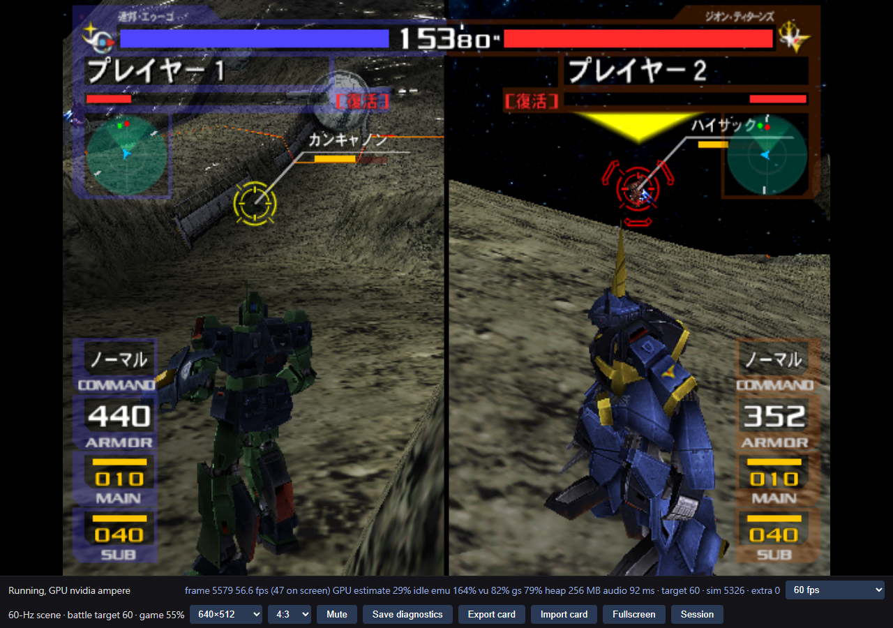
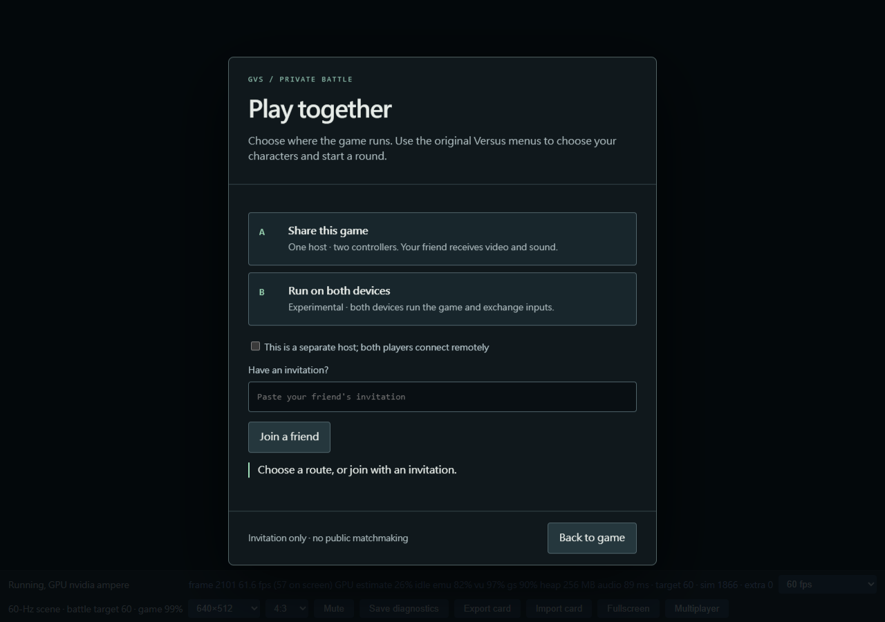

# 07 · Stream Mode: one host, remote controllers

> Prefer the illustrated reader? [Read this chapter in the Wiki](https://sennett-lau.github.io/re-gvs-gvzg/07-host-streaming.html).

> **At a glance**
>
> - **Question:** Can two devices play while a separate host does the game computation?
> - **Result:** The original Network Battle menu now opens a private room. Both host-as-P1 and a separate host with two streamed players entered Versus and started a battle. Rejoining preserved controller ownership.
> - **Still open:** Full matches on separate physical devices, phone tests and latency measurements remain.

**🟡 Partially verified · Native menu entry, active battle and same-port rejoin tested.** Stream Mode puts game computation on one host. The host can play as P1 with a remote P2, or reserve both controller ports for remote players. It can carry local Versus or other game modes. The new source profile is separate from the published adaptive package.

## Move game computation to a host

A phone that struggles to execute the translated PS2 game can still be a useful remote player. Moving game computation to a stronger host changes its workload: the phone decodes video, plays audio and captures controls. It no longer executes the game WASM. This changes where computation happens. Encoding, network and decoding delays remain.

The model follows a console with two controller ports. One game owns the combat rules, state and cameras. Both controllers act on that same game. This avoids the requirement that two independent simulations remain identical, which is the separate problem in [chapter 08](08-independent-clients.md).

> [!NOTE]
> **The host must run a game browser.**
>
> A separate host computer can run the browser and supporting services without being a player. The Python signaling service alone cannot render the game.
>
> Clients control emulated game controllers. They do not receive operating-system remote desktop access.

## What the code implements

The host captures its canvas with `captureStream(60)`, attaches the game's audio stream when available, and creates one WebRTC peer per controller port. Each peer receives the same media stream. The sender requests up to 60 video frames per second and approximately 3 Mbit/s, with motion and frame-rate preferences where supported. These are encoder settings; delivery still depends on the devices and network.

The client attaches received media to a video element and sends touch, keyboard or gamepad states on a data channel. The host maps these states to `Module.remotePads[0]` and `[1]`. Separate ports allow separate character control in a suitable two-player mode. Joining the transport does not select that mode or create another player character.

The signaling service manages one host and two player slots. An invitation contains a room identifier and an invitation credential. The host's own session credential is kept separate. The host page offers a copy action and a selected-text fallback. This is existing invitation behavior, rather than an implemented account or friend-list system.

Input release also matters. The client sends neutral input when focus is lost or the page is hidden. The host clears disconnected ports and treats input older than 750 ms as neutral. These mechanisms reduce stuck movement after an interruption. Complete match tests still need to cover mobile suspension and reconnect paths.

The current source defaults to `iceTransportPolicy: 'all'`, allowing direct and relay candidates. The server can select `relay` for comparison or deployment requirements. Internet connections still need a suitable STUN/TURN configuration; signaling alone cannot relay video. Online serving requires HTTPS. Keep deployment credentials outside the repository.

The source references and implementation summary are retained in [network-findings.json](../evidence/network-findings.json).

## Reduce streaming latency: the proposed experiment

**🟡 Implemented settings; comparative latency is unmeasured.** The [2026-10-26 source audit](../evidence/implementation-review.json) describes the earlier relay-only implementation. The integration now applies selectable ICE policy, `contentHint = 'motion'` and `degradationPreference = 'maintain-framerate'`.

`all` permits both direct and relay candidates; it is not a strict STUN-then-TURN sequence. See the [WebRTC ICE policy specification](https://www.w3.org/TR/webrtc/#rtcicetransportpolicy-enum) and [media content hints](https://www.w3.org/TR/mst-content-hint/).

Receiver buffering keeps the browser default. The optional `latency=responsive` client query requests a zero buffer target where supported, for controlled comparisons. A lower target can trade resilience for latency; it is not a measured improvement. See the [receiver API](https://www.w3.org/TR/webrtc/#dom-rtcrtpreceiver-jitterbuffertarget).

Compare the same scene and network conditions. Record input-to-visible-response latency, selected candidate type, RTT, encoded/decoded/dropped frames and receiver-buffer delay. Keep the current path as a control. This work can start with synthetic media, but a game-session comparison is required before claiming a latency improvement.

## What has been tested

The integration test used a real host game and a separate browser context as the streamed client. It selected **通信対戦**, created a room, connected the guest as P2, returned to original Versus preparation, joined the opposing team and started a battle. Movement and firing inputs were exercised. The receiver decoded 2,378 video frames during the retained trial. Leaving and rejoining reclaimed P2 without taking P1 away from the host.

The optimized-build test then used one game host and two streaming contexts. The receivers decoded 2,970 and 2,968 frames over about 55.6 seconds. The host continued when hidden; its invitation remained accessible during battle. P2 left and rejoined while P1 stayed connected.

The browser output was muted while the host audio engine remained running. These were same-PC tests with direct connectivity. See the [integration evidence](../evidence/multiplayer-integration.json).

*The dedicated host computes both players. Two browser clients controlled this battle.*

**Both streamed clients receive the same game picture.** If the game renders split-screen, both currently receive that split-screen picture. Sending each device a cropped view is a possible extension, with another choice between cropping before transmission and cropping on the receiver. Neither should be described as a new independent camera. The separate-client prototype already uses a page crop, but that implementation belongs to the other route.

The adaptive renderer also does not automatically create a 120 FPS stream. Capture, encoding, network delivery, receiver decoding and physical display refresh each impose their own limits. Raising the current 60 FPS capture setting without measuring those stages would only change a request.

## What to integrate and test next

The source profile now connects both routes through the original menu. The browser connection desk holds invitations and session settings, then closes for play. A small Session button reopens it, including in fullscreen. The host keeps running when its page is hidden, and a room can close and reopen without reloading the game. [Build and host the integration](../GAME_FILES.md#multiplayer-integration).

*The connection desk closes for gameplay. The original game still owns preparation and rounds.*

Use one host and two actual client devices for the next acceptance run:

1. Select an established two-player mode.
2. Demonstrate independent movement and firing.
3. Finish a round.
4. Return through the normal menus.

Measure input-to-visible-response latency and dropped video frames. Repeat with a disconnected controller, a hidden client page and a return to the session. Record actual TURN use and negotiated video behavior.

Use the shared [silent timing-test procedure](../EVIDENCE.md#repeatable-game-code-tests).
