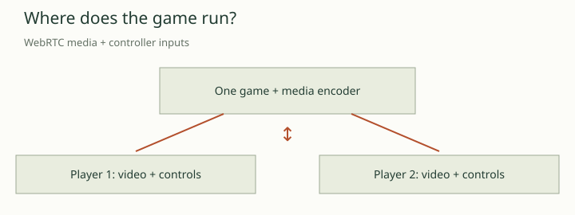

# 07 — One host, two remote controllers

> Prefer the illustrated reader? [Read this chapter in the Wiki](../../.local/wiki/07-host-streaming.html).

**Report date: 2026-10-25.** Streaming is the first multiplayer route: one browser runs the game, while two other devices receive its picture and sound and send controller input. The implementation exists in the research working tree. A user reported that two devices controlled the same screen. A retained, complete match with a separate host and two remote clients, measured latency and disconnect recovery is still missing.

## The problem and the chosen boundary

A phone that struggles to execute the translated PS2 game can still be a useful remote player. Moving game computation to a stronger host changes its workload: the phone decodes video, plays audio and captures controls. It no longer executes the game WASM. This addresses the location of computation; it does not remove encoding, network or decoding delay.

The model follows a console with two controller ports. One game owns the combat rules, state and cameras. Both controllers act on that same game. This avoids the requirement that two independent simulations remain identical, which is the separate problem in [chapter 08](08-independent-clients.md).

```text
Remote player 1 ── pad 1 input ──┐
                               ▼
                        Host browser
                       One running game
                               ▲
Remote player 2 ── pad 2 input ──┘
                               │
                      Canvas + game audio
                               │
                       WebRTC to both players
```

This is control of the game through emulated controllers. It is not operating-system remote desktop access. A separate host computer can run the browser and the supporting services without being a player. Running only the Python signaling service would leave no game to render.

<!-- interactive: multiplayer-routes -->



## What the code implements

The host captures its canvas with `captureStream(60)`, attaches the game's audio stream when available, and creates one WebRTC peer per controller port. Each peer receives the same media stream. The sender requests a maximum of 60 video frames per second and approximately 3 Mbit/s; these are configured limits, not measured delivery guarantees.

The client attaches received media to a video element and sends touch, keyboard or gamepad states on a data channel. The host maps these states to `Module.remotePads[0]` and `[1]`. Separate ports allow separate character control when the game is in a suitable two-player mode; joining a transport does not itself select that mode or create another player character.

The signaling service manages one host and two player slots. An invitation contains a room identifier and an invitation credential. The host's own session credential is kept separate. The host page offers a copy action and a selected-text fallback. This is existing invitation behavior, rather than an implemented account or friend-list system.

Input release also matters. The client sends neutral input when focus is lost or the page is hidden. The host clears disconnected ports and treats input older than 750 ms as neutral. These mechanisms reduce stuck movement after an interruption; they are not evidence that every mobile suspension or reconnect path has passed a complete match test.

Both WebRTC endpoints currently force `iceTransportPolicy: 'relay'`. This implementation therefore needs a working TURN relay. A signaling endpoint alone does not relay the media, and this configuration does not fall back to a direct connection. Online serving requires HTTPS. These requirements belong in future setup instructions, with deployment credentials kept out of the repository.

The source references and an explicitly selected implementation summary are retained in [network-findings.json](../evidence/network-findings.json). They describe inspected code; they are not a new runtime benchmark.

## What has actually been demonstrated

The user's two-device observation is encouraging evidence for connection and input, but does not establish latency, image quality, every character combination or a full match. Separately, native experiments proved that the original Arcade challenge fixture has two independently controlled opposing players. That result establishes a usable game mode; it does not turn the streaming observation into a completed end-to-end acceptance test.

Both streamed clients seeing the same screen is expected. If the game renders split-screen, both currently receive that split-screen picture. Sending each device a cropped view is a possible extension, with another choice between cropping before transmission and cropping on the receiver. Neither should be described as a new independent camera. The separate-client prototype already uses a page crop, but that implementation belongs to the other route.

The adaptive renderer also does not automatically create a 120 FPS stream. Capture, encoding, network delivery, receiver decoding and physical display refresh each impose their own limits. Raising the current 60 FPS capture setting without measuring those stages would only change a request.

## Decision and next proof

Retain streaming as the lower-complexity route for friends whose client devices cannot run the game smoothly. Keep its source and acceptance work separate from the independent-client proof of concept until they are integrated into the full-game launcher.

The next acceptance run should use one host plus two actual client devices, select an established two-player mode, demonstrate independent movement and firing, finish a round, and return through the normal menus. Measure input-to-visible-response latency and dropped video frames. Repeat with a disconnected controller, a hidden client page and a return to the session. Record actual TURN use and negotiated video behavior.

Tests should remain silent while the audio engine continues consuming its ring buffer through a zero-gain output. Suspending audio would change the workload and invalidate a timing comparison. Until these checks are retained, describe streaming as an implemented research route with user observation, rather than a finished low-latency multiplayer release.
