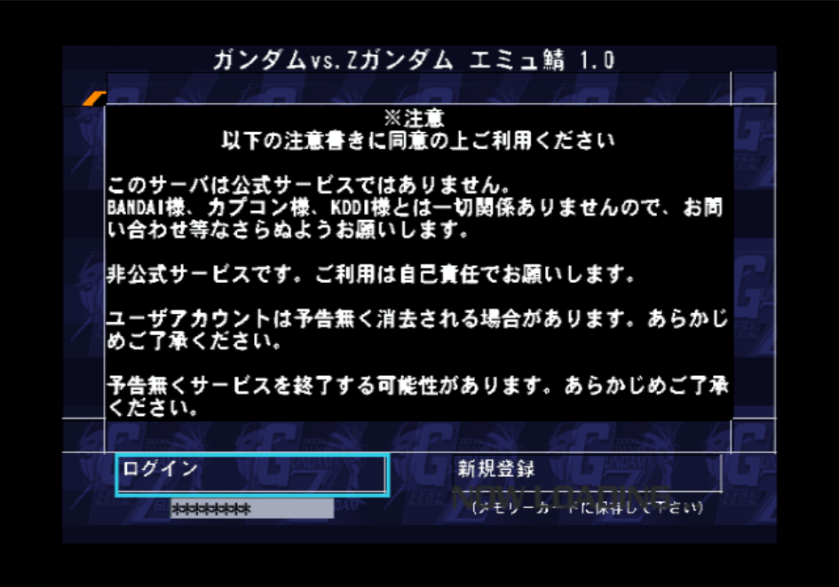
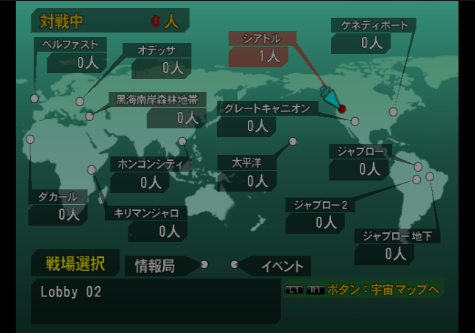
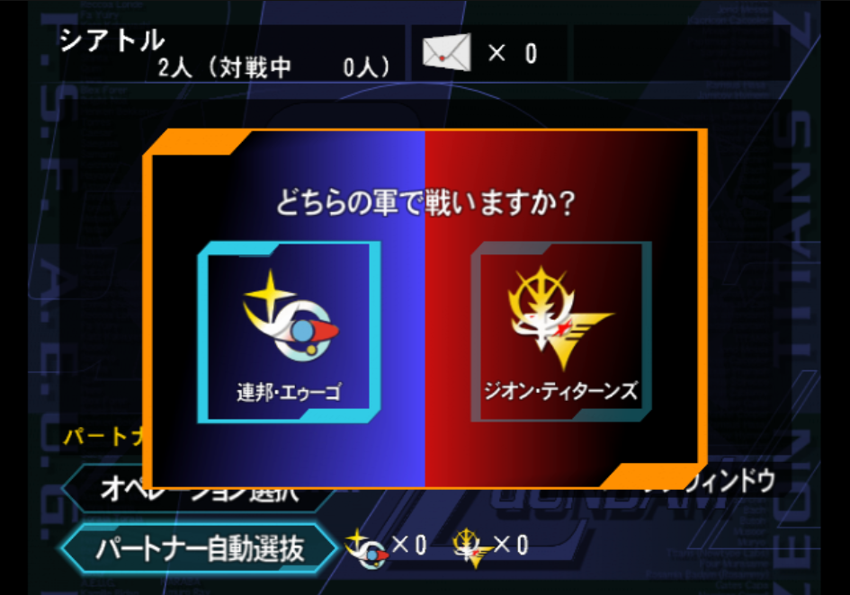
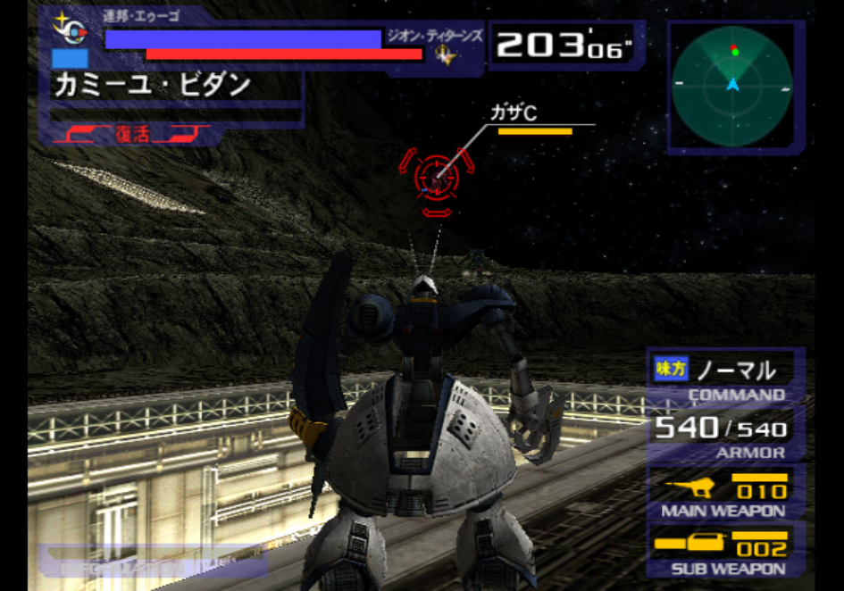
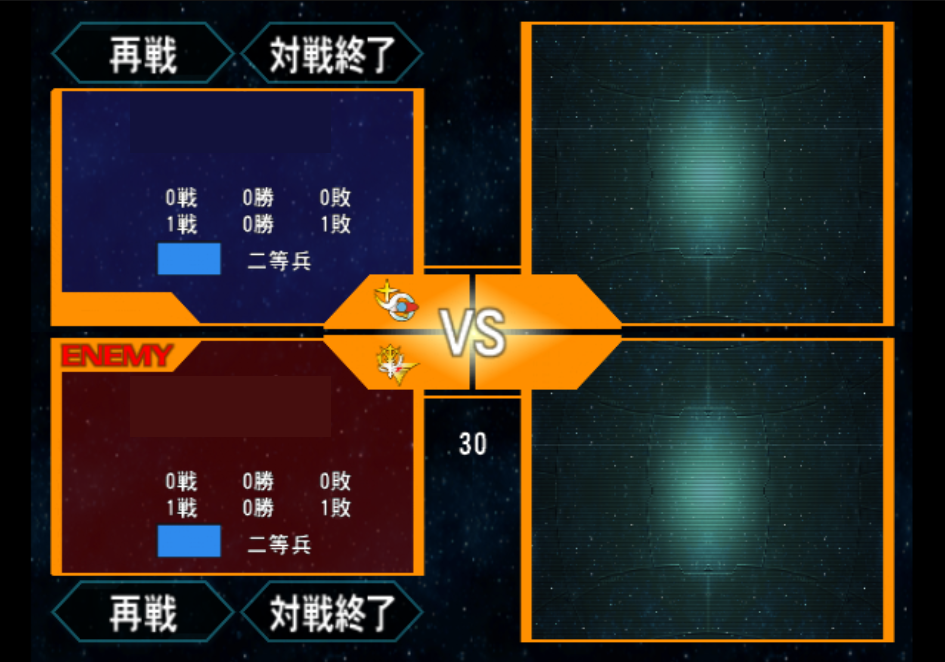
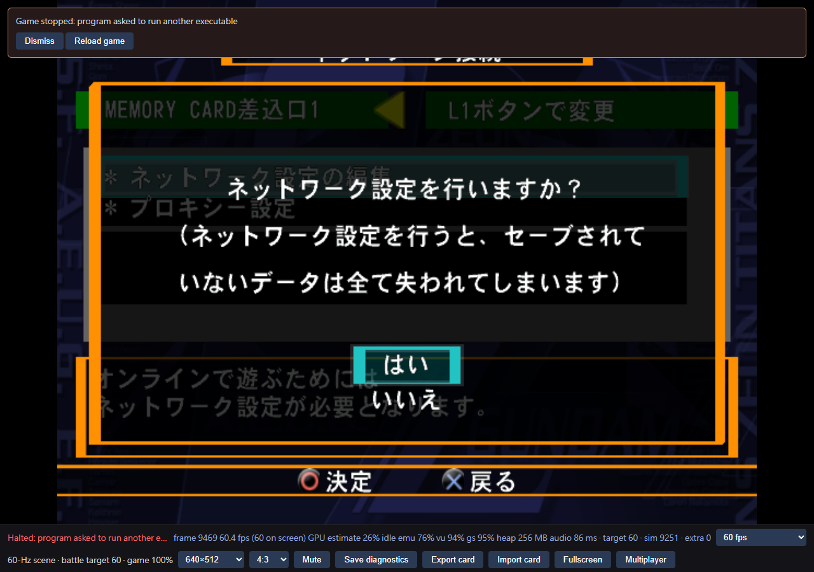
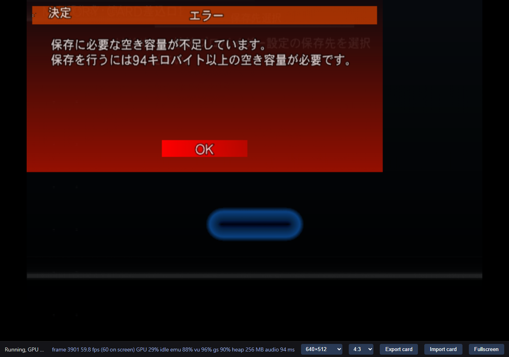
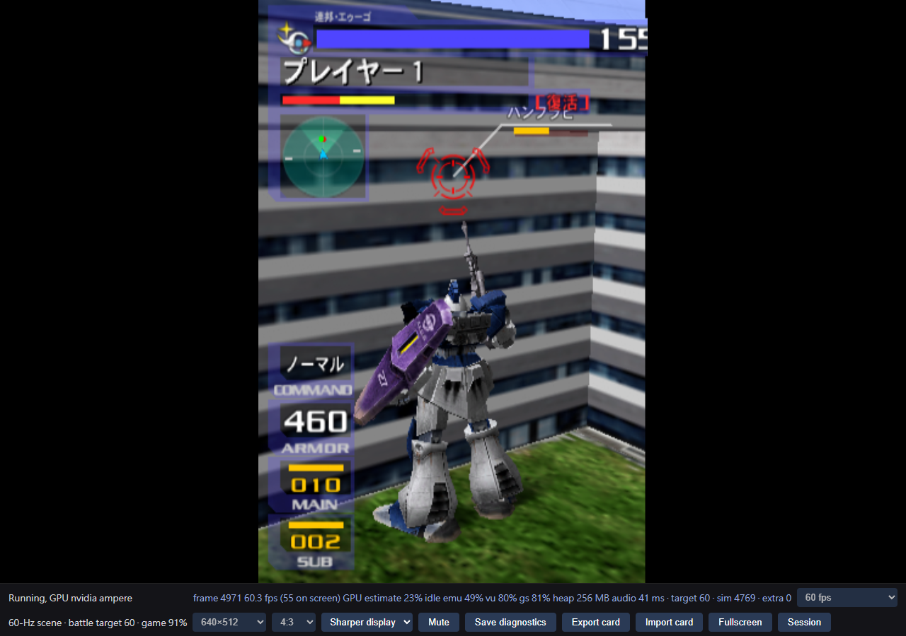
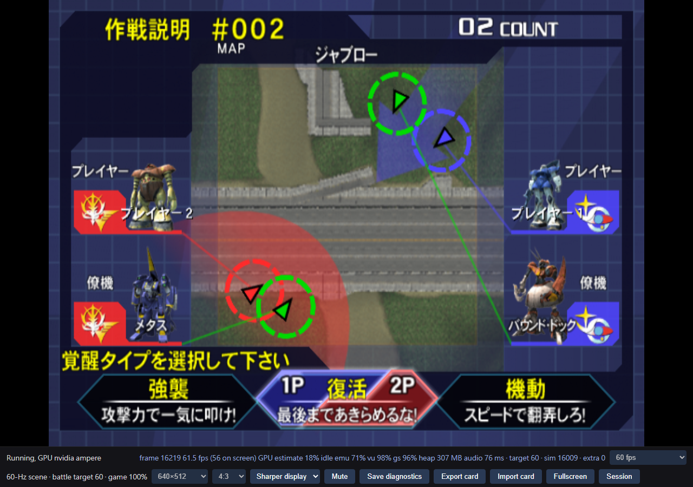

# 08 · Online Mode and the independent-client experiments

> Prefer the illustrated reader? [Read this chapter in the Wiki](https://sennett-lau.github.io/re-gvs-gvzg/08-independent-clients.html).

> **At a glance**
>
> - **Question:** Can two independent game instances use the original 通信対戦 lifecycle?
> - **Result:** Yes, through a private compatible backend. Two original mode `7` clients registered, logged in, met in a lobby, played full matches, posted results and returned to the lobby. This worked on one PC and between a PC and a MacBook Pro. A separate lockstep POC synchronized local Versus through checkpoint 13,560.
> - **Still open:** Public hosting, four-player sessions, phones and a backend restart during a battle. The Online corrections remain opt-in build profiles.

**Online Mode** means two independent instances using original **通信対戦**, mode `7`. **Stream Mode** runs one host with remote controllers, in local Versus or another mode. The earlier lockstep POC returns mode `4` and does not meet the Online Mode goal. This chapter describes Online Mode first, then the lockstep experiment.

## Original Online Mode works end to end

**✅ Verified · Original mode `7`, private backend, PC and MacBook Pro.** Two independent original clients played complete Online Mode sessions. Each ran in its own Chrome context with its own memory card. A private compatible backend supplied every service. Output was muted while audio processing continued.

> [!IMPORTANT]
> **Three unattended matches in a row reached results and the lobby.**
>
> In capture39 a test probe drove both clients with ordinary pad input only. The backend stored **6 of 6 results**, and both clients returned to the lobby map after each match. Battle averaged **59.98 fps** on each client.
>
> Scope: both clients on one Windows PC in two Chrome contexts. The private backend ran on a Mac and was reached through an SSH tunnel. Opt-in build profile. [Stability evidence](../evidence/original-online-path.json).

No step replaces the original game's network code. The client runs its own DNAS authentication, its own HTTPS login and the original lobby and battle protocol. This is not the local-Versus lockstep POC described below, and it is not Stream Mode.

### What one session does

```text
Original client, mode 7        → private backend
1. saved connection, DEV9/SMAP,
   DHCP lease (inside the browser)
2. DNAS authentication (TLS)   → DNAS service
3. top page, registration,     → login proxy
   login
4. lobby map, battlefield,     → lobby
   room, faction choice
5. automatic pairing           → battle allocation
6. battle (0x6916, 0x4110)     → TCP battle relay
7. continue/end panel, result  → battle_record
8. after-battle room, lobby map
```

Steps 2 to 7 reach the backend through the browser's only network endpoint, a capability-protected WebSocket gateway. It carries TCP streams and DNS datagrams to the configured services only. The battle relay forwards complete battle frames unchanged. It does not emulate the game or decode gameplay. The [server README](https://github.com/sennett-lau/re-gvs-gvzg/tree/main/apps/server) describes the services, their logs and their security limits.

The backend is a pinned build of [zdxsv](https://github.com/inada-s/zdxsv/tree/35ffbdad9257eca5043bb4977d26cc07468b5045) with recorded patches. The runtime corrections are opt-in. The build profile `--original-online-v2` applies all of them, and the default game build stays byte-identical.



*The original browser shows the compatible server's top page with ログイン (login) and 新規登録 (registration). The server text states that it is not an official service. Game-derived capture, capture57.*



*The original lobby map. The server describes the Seattle battlefield as `Lobby 02`. Game-derived capture, capture57.*



*Each client chooses a side in the room. One chose 連邦・エゥーゴ and the other ジオン・ティターンズ, then the backend paired them. Game-derived capture, capture57.*



*The first Online battle, at ソロモン. The target marker shows the opposing side's CPU partner. Game-derived capture, capture26.*



*After each match the original panel offers 再戦 (rematch) and 対戦終了 (end). Pilot IDs and names are hidden in this copy. Game-derived capture, capture57.*

### Stability evidence

Every run used two clients. Each capture's receipt comes from the backend logs and a read-only database query.

| Check | Result | Runs |
| --- | --- | --- |
| Profile rebuilds from Git history | Same game WASM from separate source archives. Default build unchanged. | build30–33, build42–45 |
| Repeated unattended matches | 3 of 3 matches, 6 of 6 results, 3 after-battle room cycles | capture39 |
| Every unattended match since capture31 | 13 matches in 9 runs reached results and the lobby. A deliberate disconnect ended one. | capture31–57 |
| Opponent leaves during a battle | The other client ended the battle itself **13.1–13.2 s** later with its original "peer lost" error | capture33, 34, 37 |
| Same card rejoins after a drop | Logged in with the same pilot 30 s later and played another full match | capture37 |
| Backend restart between sessions | Restart took 1–3 s. Database and token unchanged. The same pilots logged in and played. | capture36 |
| Backend restart while both clients wait in the lobby | About **121 s** later each client showed the original disconnect notice, then logged in again | capture40 |
| PC and MacBook Pro | Full match over direct tailnet listeners and over SSH tunnels. Battle about **60 fps** on both devices. | capture35, 36 |
| Full diagnostic log | **20,039** against **856** console lines per minute, with the same battle frame rate | capture41 vs 39 |
| Login stall fix (B34) | Stalled logins fell from **7 of 8** to **0 of 10** | MacBook Pro A/B runs 45–55 |
| Release candidate `original-online-v2` | One unattended match. **59.99 / 60.00 fps**, no page or runtime error. | capture57 |

The relay carried **18.5–19.8 battle frames per second** in each direction in these runs. The longest gap between frames was about **2 s**. A relay session lasted until a player chose 対戦終了, or nobody answered the panel for 30 s.

The original client sends zero match, win, loss and kill counters unless a session has four players. Every one-against-one result therefore reports zeros. The backend parses and stores them as sent.

### Technical findings

Each boundary below appeared in a real run on the PC or the MacBook Pro. The returned-thread and SIF-latency fixes were proven with A/B builds: the same card, route and backend, with one change between builds.

#### A returned thread starved the login request

- **Symptom:** after the third TLS handshake the game showed NOW LOADING and sent no HTTP request. Frames and audio continued.
- **Evidence:** a read-only thread snapshot showed the browser library's worker at `kIdle`, still running. Its equal-priority supervisor was ready and never ran.
- **Cause:** the pinned runtime gives each EE thread `kIdle` as its return address. The finished worker therefore stayed current. On a PS2 a returned thread ends as `ExitThread`.
- **Fix:** route a thread that reaches `kIdle` through the runtime's existing `ExitThread` path. Two builds differed only in this change. The first reproduced the stall, and the second sent the login request at once.

#### Calls crossed separately translated images

- **Symptom:** the top page and the registration step stopped with missing-code errors.
- **Evidence:** the main executable calls four functions in the browser overlay, including zlib `inflateInit_` and `inflate`. The overlay calls two allocator thunks in the main executable.
- **Cause:** the recompiler analyzes each image alone. Two of the targets were entries only in another overlay that loads at the same address.
- **Fix:** two independent scans checked every call target against the image actually loaded. They agreed on four targets. One combined rebuild then ran through the battle without another stop. Each rebuild took about 20 minutes.

#### Zero-latency SIF replies delayed some logins by minutes (B34)

- **Symptom:** on the MacBook Pro, 5 of 9 logins stalled for 3–4 minutes before the login completed. The PC showed no stall in 10 logins.
- **Evidence:** the backend saw a DNAS connection with no request, and the client logged an idle HTTPS socket. The priority-63 library worker stayed ready behind two higher-priority loops.
- **Cause:** the runtime's high-level SIF RPC replies arrive with zero latency. A synchronous RPC therefore never blocks its caller, and the lower-priority thread rarely runs.
- **Fix:** deliver each IOP-to-EE SIF packet **100 µs** after it was queued.

The A/B used both clients per run, in the order C L L C C L L C C L C. The control arm stalled in **7 of 8** logins and the latency arm in **0 of 10**. A one-sided Fisher exact test gives **p = 2.5 × 10⁻⁴** per login, or **p = 0.008** per run. The two clients in one run are not independent, so the per-run value is the conservative figure. The result held at host load averages of 2 to 22. Load, login and battle times did not change measurably. 100 µs is an effective value from this experiment, not a measured PS2 timing.

#### One shared TCP stream slowed the lockstep battle

- **Symptom:** in capture31 a round took 15–24 minutes instead of about 4–5. Both clients still rendered 60 fps.
- **Evidence:** both clients ran on a MacBook Pro using Wi-Fi on another subnet. Frame delivery had a median of 17 ms, but the 90th percentile was **785 ms** and the 99th **1,161 ms**. The tunnel transport had retransmitted 6.3% of its bytes.
- **Cause:** every connection of the device shared one SSH tunnel, which is one TCP stream. One lost packet delayed every battle frame of both clients. The battle relay is lockstep, so each client waits for the slowest frame.
- **Fix:** direct tailnet listeners give each game connection its own TCP flow. Later cross-device matches kept normal pacing on both paths, because the LAN paths had little loss.

#### A late close removed a re-logged pilot

- **Symptom:** after a reconnect the pilot was never paired, and the lobby logged `Failed to start battle`.
- **Cause:** upstream zdxsv removes a user by ID when a lobby connection closes. An old connection that closed late removed the new session.
- **Fix:** a late close now keeps the newer session and logs a `stale-close` event. A regression test fails without the fix, and every backend build runs it.

#### Smaller boundaries

| Symptom | Cause | Correction |
| --- | --- | --- |
| Uncaught exception on the first TCP open | Chromium rejects `TextDecoder` on shared WASM memory. Node accepted it. | Copy the host name, at most 253 bytes, before decoding |
| TCP connected, but no TLS bytes were sent | A completion stub lay below the module address and failed an ownership check | Admit only the exact owned stub, tested with reversed address layouts |
| Lobby map pointer did not move | The test page mapped only part of the pad | Map every ordinary button and the left analog stick |
| A registered card took the wrong route | After registration the default option becomes 前回と同じ接続 (same connection as last time) | A separate saved-connection route in the probe |
| The probe fell behind the log stream | The full observer writes about 20,000 lines per minute | Counter-only quiet logs, a bounded buffer and an explicit lag error |

### The path from mode 7 to battle

The first runs stopped at a sequence of runtime and recompiler boundaries. Each row was the first stop at that stage.

| Stage | First stop | Cause | Correction |
| --- | --- | --- | --- |
| Settings | **“program asked to run another executable”** | The settings editor starts a separate utility with `LoadExecPS2` | Separate utility translation and a browser-level executable switch |
| Card | The utility reports that saving needs 94 KB | The card driver registered by the utility never received `mc0:` calls | Guest driver dispatch on the calling IOP thread |
| Device | **接続機器がありません** (no connection device) | No DEV9/SMAP device, a wrong module version field and no resident module lookup | Virtual adaptor, original version field and resident name lookup |
| Address | The link never came up | The virtual adaptor had no peer | Per-client virtual segment with ARP and one DHCP lease |
| DNAS code | Missing code, then stale encrypted code | The DNAS overlay rewrites 117 code ranges at run time | Guarded blocks and byte-verified decoded variants |
| Console identity | Errors **-401** and **-402** | CDVD exports 80, 82 and 79 were absent | Exports that follow the original routines, and a labeled disc-ID model |
| Callback | Missing code at `0x01189CE0` | A function pointer from a data table | Guarded entry from a verified runtime miss |
| Host name | Exception on the first TCP open | Shared-memory decoding, as above | Bounded copy before decoding |
| TCP | Handshake completed, no TLS bytes | Completion stub address, as above | Exact owned stub |
| Login | **NOW LOADING** after the third TLS handshake | Returned thread, as above | `ExitThread` on return |
| Top page | Missing code at `0x011AE360` | Calls between separately translated images | Cross-image entries for zlib and allocator thunks |
| Registration | Missing code at `0x011AF870` | Two overlays share one address window | Entries checked for each image separately |
| Lobby map | The pointer did not move | Partial pad mapping | Full pad |

Test-harness failures are recorded separately. Captures 27, 30, 32, 33, 34 and 38 stopped on probe or environment faults, not game or runtime faults.

The first battle began at **21:45:33 UTC on 2026-10-30**, in capture26 on one PC. Both clients joined one battle relay 10 seconds after the backend paired them. Each sent about 45 KB and received about 234 KB through the relay, at about 59.7 fps.

### Limits of the current result

- **Private backend only.** Services listen on loopback. Other devices reach the gateway over the tailnet or an SSH tunnel. No public host, NAT traversal or phone has been tested.
- **Two tested hosts.** A Windows PC with Chrome and a MacBook Pro. Each session had two players.
- **Untested events.** A backend restart during a battle, a four-player session and a long idle session.
- **A disc is still required.** The host supplies a supported disc image. No release includes the ISO.
- **The probe's main menu is blind.** It presses a fixed sequence, because the chosen menu item is visible only after confirmation. At 45–55 fps under heavy host load it sometimes missed Online. This limits the test harness, not play.
- **Opt-in corrections.** The default game build contains none of them. The returned-thread, cross-image and SIF-latency corrections are candidates for the upstream runtime and recompiler.

## How the original online mode differs

The subsections below record the first Online Mode boundaries as they were found. Later work resolved each of them. [The path from mode 7 to battle](#the-path-from-mode-7-to-battle) lists the corrections.

The second main-menu entry, **対戦 / VS. Battle**, is local Versus. The second-last entry, **通信対戦 / Network Battle**, has its own online lifecycle. Offline analysis verified this dispatch chain:

```text
Network Battle selection → mode 7 → lobby/battle stage dispatch
                         → shared battle engine at 0x2B19F0
```

The original executable contains UI for both automatic matching and named operations (rooms), including title/password prompts, faction selection and returning to lobby chat. Verified string references and original instructions support the interpretation that friends could deliberately choose the same lobby and room. This review did not recover a modern shareable invitation URL, or establish an original server connection.

The compatible [zdxsv server](https://github.com/inada-s/zdxsv/tree/35ffbdad9257eca5043bb4977d26cc07468b5045) is a useful protocol reference. The inspected revision has separate authentication, lobby and battle responsibilities. Its password permission is disabled, password lookup is unfinished, and friend handlers are stubs. A password field is not working room access control.

Changing a hostname is therefore insufficient. The original connection calls still need mapping to a browser-compatible runtime bridge. Server-supplied R5900 patches also need review: writing guest machine code does not prove the static translation will execute the new behavior.

These are separate implementations with different acceptance criteria:

| Integration option | Work needed | Current status |
| --- | --- | --- |
| Experimental lockstep POC | Agree on settings, then synchronize local Versus | Normal boot, selection and battle tested. Does not implement Online Mode. |
| Original Online Mode | Preserve mode `7` and bridge its native network/session requests | Full sessions, results and lobby return through a private backend, on one PC and across two devices. Opt-in runtime corrections. |

An Online Mode invitation should identify its server and room. Browser invitation handling alone cannot replace the native session lifecycle.

### The native boundary and first bounded implementation

**Verified statically · Original ELF and IRX bytes.** Mode `7` reaches connection dispatcher `0x368A80` through initializer `0x306A90`. Its state record starts at `0xCD1360`. The battle path remains `0x307E30 → 0x2B19F0`.

The EE binds RPC service `0x01270030` at `0x30E2E0`. Both disc wrappers, `AVEWRAPM.IRX` and `AVEWRAPE.IRX`, register that service. `USBSRCH.IRX` registers the separate device-search service `0x01270010`.

The modem wrapper dispatches 66 method slots. Method `1` forwards three words from request offset `28` to `avetcp` import `4`, opcode `0x4105`. The EE stages requests at `0xC22C80` and reads a signed result at offset `24`. These are local RPC fields, not a recovered Internet packet format. [Original-word checks and selected module identities](../evidence/original-online-boundary.json).

The runtime has concrete gaps before a compatible server can help:

- LoadFile method `9` always returns `-202`, even for a loaded module.
- The module registry stores filename stems. The game queries internal names such as `INET_SMAP_driver`, rather than `SMAP`.
- Missing RPC services time out. Original bind callers retry, so returning mode `7` alone can leave initialization waiting indefinitely.
- DEV9/SMAP device handling is absent. Unmatched registers use a generic register map, and unsupported DMA channels complete without device emulation.

The isolated observer in `poc/original-online/` preserves every original instruction and records mode, connection state and SIF call metadata. An optional module-discovery slice reads real IRX names and answers LoadFile method `9` from the loaded-module registry. Unknown modules still return `-202`, and freed nonresident modules are removed from the registry. A matching name does not establish successful startup or RPC registration. Neither component supplies network success or bypasses battle synchronization.

Native helper tests passed malformed-input and missing-module cases, plus the original SMAP and Ethernet-wrapper module names. Both optional runtime files compiled with Emscripten `6.0.11`. Full-game effectiveness of that slice remains unverified. The working Stream Mode and lockstep builds remain separate.

### Original setup reaches an unsupported executable handoff

**Measured · Original mode `7`, one PC instance.** Normal boot and ordinary inputs now reach NET-file creation, card formatting, NET-file reload and the original broadband settings screen. Confirming the settings editor then stops with **“program asked to run another executable.”** This is the first observed runtime blocker on this path. No server connection, second client or online battle was demonstrated.



*The original settings confirmation reaches the runtime's deliberate halt. This single-instance capture is not an online connection.*

The original call chain selects `LoadExecPS2` syscall `6` and disc utility `NTGUIDVD/NTGDVDJ.BIN`. Its arguments name the main game and return option `1`. The utility has its own executable entry and overlaps the main game's addresses. Continuing requires its own translation and machine lifecycle; returning success from the existing stub would not run the utility.

Before the halt, original `NETCNF.IRX` and `NETCNFIF.IRX` loaded and started. The observed service `0x80001101`, method `101`, returned word `0`. Independent original-byte inspection identifies that method as workspace allocation, not saving network settings. The fresh private card's NET file was found and loaded on replay, but a network configuration has not been created.

The decisive trace retained **5,542 observer events with no reported drops**. The game stayed in mode `7`. Output was muted; the AudioContext stayed running, while audio-ring production and consumption stopped when the runtime halted. The probe correctly failed its no-failure and continued-consumption checks. [Trace phases, original words and build fingerprints](../evidence/original-online-boundary.json).

Earlier attempts exposed test limitations: a neutral-only capture had a black game area, an export preceded saving, one trace hit its cap, and an automated confirm arrived before the first native timer expired. The corrected harness waits for both timers and records input phases. The interactive desktop displayed the original UI, but the runner and observer both changed, so the black capture's cause remains unisolated. The optional module-discovery slice remains off; its static gaps were not the observed cause of this halt.

### A separate utility boot reaches the card-file boundary

**Measured · Original utility, one isolated PC instance.** The network-settings utility now runs separately with its own generated dispatch, the pinned generic runtime and a copy of the fresh test card. Its live startup arguments are the helper pathname, main-game pathname and `1`. This separate boot does not implement the unsupported in-game executable handoff.

The first automatic translation stopped at indirect callback `0x1B2DA0`. Adding that observed entry reached an untranslated original thread at `0x1B4960`. Original caller/prologue words and both missing dispatch entries were checked. Adding only those two translation seeds preserved the guest instructions and reached the utility's own menu.

Two ordinary Circle confirmations then reached save-destination selection and chose memory-card slot 1. The utility attempted **`mc0:/BWNETCNF/BWNETCNF`** three times. The runtime reported an unsupported device, and the original UI displayed an error saying that saving requires **94 KB**. That message is **not a measurement of actual free space**; the native error-to-capacity path remains to be traced.



*The separately booted original utility accepted normal menu input and reached its card-file path. The exported test card remained byte-for-byte unchanged. No network configuration was saved.*

The controlled capture retained **47 samples through frame 6,038**, with advancing audio consumption and output muted. Producer tracing was disabled: 70 application log messages and five browser WebGPU warnings were captured, with zero browser-log suppression. An earlier full-trace attempt timed out during a screenshot and retained about 94 MB of console output; its stale sample does not establish a guest deadlock. Menu text still overlaps in the quiet capture, so rendering also needs correction. [Builds, original words, input timestamps, screenshots and failed attempts](../evidence/original-online-boundary.json).

Existing game saves use the serial card device. They do not establish a host file interface for the utility's `mc0:` path. The generic file layer accepts disc/ROM files and returns `-2` for this unsupported device. Its IOP write implementation and both EE fileio write handlers can return a byte count without persisting data. An open-only change would therefore risk a false save result.

The next bounded step is to observe the original card driver's registration, operation table and real completion/error values. A faithful adapter must preserve scheduling and all write paths, then demonstrate close, flush and fresh-process readback on a disposable card clone. The current nested guest-callback helper suppresses normal scheduling, so it cannot simply be assumed safe for blocking card operations. Utility rendering, executable replacement, DEV9/SMAP and the original network session remain separate gaps.

## The local-Versus lockstep experiment

**🟡 Partially verified · Experimental local-Versus lockstep.** The retained POC runs a copy on each device and exchanges inputs and state checks. It has no video stream. Its normal-boot results preserve useful transport evidence. It does not implement Online Mode.

### Start with two independently controlled players

A fixture is a fixed test setup with known players, state and inputs. Connecting two pad slots alone did not establish independent player control. Native tests first compared neutral input with P1-only and P2-only movement and firing. Each port changed its assigned human actor, while the other human's position and ammunition matched the neutral run at all 181 sampled boundaries. The fixture places the two human players on opposing sides, each with a CPU partner, using the game's original vertical split screen.

Two native processes then executed 300 frames through an HTTP input relay, with one starting three seconds later and irregular 75 ms input delay. All 301 compared boundaries agreed, including final RAM and serialized machine state. A negative control applied the wrong input at tick 40: the first RAM difference appeared at tick 41, and both clients stopped at checkpoint 60. The failure detector was part of the proof.

These tests establish actor ownership and a bounded deterministic baseline. They do not prove browser or cross-device agreement. In the browser prototype, each client still renders the original two-player scene. CSS displays its own half. This provides separate views without a new full-width camera renderer or a reduction to rendering only one player view.

### Fix startup failures and state mismatches

The transport assigns player slots and agrees on build and initial-state identities. It buffers future inputs. Both copies wait for the shared input pair before each 60 Hz simulation tick. This approach is called lockstep.

**The earlier prototype used a three-frame input delay.** This provides about 50 ms of scheduling lead at 60 Hz. The normal-boot integration now measures both relay connections before choosing one shared delay. It waits for game loading to finish before measuring. The initial delayed ticks still use neutral input. Legacy callers retain the three-frame default. [Earlier source inspection](../evidence/implementation-review.json) and [current integration evidence](../evidence/multiplayer-integration.json).

At checkpoints, it compares full-RAM hashes from both copies at the same gameplay tick. Missing input pauses progress. Mismatches stop the session. There is no rollback or mid-match resynchronization.


A generic halt message initially hid whether failure came from transport, an expired lease or differing state. Diagnostics were changed to preserve the precise JavaScript error and checkpoint. An injected-clock test reproduced a 31-second initialization expiring a 30-second lease. Startup recovery now reclaims only the same player's slot before gameplay begins, resumes the initial input window and has a bounded deadline. This reproduced a possible failure. It did not identify the cause of every user's phone report.

A later browser pair still diverged at checkpoint 120 despite matching initial hashes and effectively neutral inputs. Replaying its exact inputs natively ruled out unequal controls. The next hypothesis concerned asynchronous disc loading: a false browser readiness result postponed an emulated CDVD completion by 1,000 guest microseconds. Identical disc bytes could therefore arrive at different **game times**.

A controlled native experiment changed only readiness responses. Twenty false probes reproduced a previously observed browser hash, with the first RAM difference at tick 10 and 11 changed bytes at tick 120. Some were RPC counters. Similar actor positions were not a reason to exclude those bytes from comparison.

The corrected policy waits in host time for required bytes while preserving the scheduled guest completion time. Short or failed reads halt execution. State checks remain intact. Two controlled browser trials delayed one client's relevant HTTP chunk by 600 ms and matched native checkpoints. In the diagnostic trial, all 32 MiB of checkpoint-240 RAM matched between both browsers and native replay, with zero excluded regions.

### What the longer browser test proves

**23 checkpoints agreed across 44 guest seconds.** Both Chrome instances matched checkpoints **0 through 2,640**. **Both ran on the same desktop with neutral inputs**, and one used mobile configuration. [Evidence: browser release stress](../evidence/network-findings.json).

The test used the release candidate's unchanged JS/WASM. A wrapper selected delayed disc routes and observed checkpoints. There were harmless missing-favicon requests, but no recorded game/page exception.

The selected values and source hashes are in [network-findings.json](../evidence/network-findings.json). Actor-control checks cover movement and firing; the longer browser run covers continued checkpoint agreement. The remaining acceptance target is an active full match across separate devices.

#### Measure checkpoint cost and input waiting

**The live checkpoint hash is FNV-1a 64-bit, not SHA-256.** `web_netplay.cpp` scans all 32 MiB of RAM every 120 ticks, before requesting the shared input pair. The release identifies this scheme as `fnv1a64-full-ram-before-input-v1`. Its cost on a phone has not been measured separately.

The native `waitMs` counter starts **after hashing**. It combines browser dispatch, checkpoint agreement and input waiting. The transport now separately records empty-input-buffer waits, recent request timings, retries and the first failure. Diagnostics exclude room credentials from those records. Hash durations and checkpoint-barrier timings still need separate instrumentation before comparing another hash such as XXH3. Both peers must agree on the algorithm and version. The deliberately wrong-input test must still detect divergence. File-audit SHA-256 hashes have a separate purpose.

Setup takes five round-trip samples per player. The HTTP fallback uses twice the largest sample plus two ticks, rounded up and bounded to 3–30 frames. Both players must report before starting. The delay stays fixed after the first input or checkpoint. This conservative policy trades control latency for fewer network stalls. It needs further tuning on separate devices.

#### Recover from Tunnel delays and lost replies

**🟡 Partially verified · Public Tunnel, two browser contexts on one PC.** A player report showed roughly 16–20 FPS while still on the no-card prompt. The friend disconnected afterward, so the final missing-peer error did not explain the earlier repeated screen.

The fix preserves short button presses between slow frames and offers Player 1 a **Continue without saving** button. It sends ordinary Left and Circle inputs through the relay. Player 2 waits. No guest memory is changed to bypass the prompt.

The transport also prefetches agreed inputs while the game consumes its current buffer. A real Tunnel test then exposed a separate retry bug. The server had accepted an input batch, but its reply failed. Both clients consumed those inputs before the retry arrived, pruning the server's history. The retry was incorrectly rejected as out of order. Each player now retains 128 accepted input receipts independently of that history. Matching retries succeed, while conflicting duplicates still fail.

With these changes, a second real-game test passed normal boot, both Ready actions, movement, firing and pause/resume. Both copies agreed at tick **4,800**, despite recorded network retries. Browser audio output was muted while audio processing continued. The input buffer was **10 frames**, about **167 ms** of scheduling lead. This is a bounded Tunnel test, not a completed match between separate households. [Selected results and source hashes](../evidence/multiplayer-integration.json).

#### Rollback needs more than a RAM copy

**⬜ Untested · Rollback is future work.** Restoring a tick requires RAM, CPU/IOP state, pending events, device state and deterministic external inputs. Dirty-page snapshots could reduce RAM-copy work, but they do not capture those other components automatically.

First measure snapshot size, save/restore time and a replay checksum in the existing fixed-60 fixture. Retain a full-state reference snapshot before testing incremental pages. A correct rollback design must also handle speculative audio and presentation. The current lockstep implementation waits for missing input instead of predicting it.

### Move from the fixture into the full game

The experimental lockstep profile intercepts **通信対戦 / Network Battle** at `0x211180`. Its browser connection desk creates or joins an invitation-only room. It then enters original **local Versus** screens. This is the historical POC, not original Online Mode integration.

```text
Original Network Battle selection
  → choose shared host or independent games
  → private invitation and controller ownership
  → original Versus preparation
  → P2 presses Start; both players select Ready
  → two-human battle
```

The menu hook returns mode `4` for Versus and changes the selected-mode byte to `1`, matching the original Versus path. Cancel returns mode `2`. The original generated file stays intact; [the build adapter](../../scripts/game/multiplayer.py) prepares an override, and [the native bridge](../../src/multiplayer/menu_bridge.cpp) waits for the browser's choice.

Independent games need an agreed starting point. Creating a room from a running game reloads into a normal boot with a fixed RTC, no personal memory card, deterministic disc completion and 60-Hz rendering. The invitation identifies this boot recipe and the executing build. Player 1 uses **Continue without saving**, or selects **はい / Yes** with the controller, then chooses Network Battle or Versus. Each browser's controls map to its authenticated player port.

> [!IMPORTANT]
> **Normal boot, active battle and round end agreed through tick 13,560.**
>
> Two isolated browser contexts on the same PC reached original preparation, joined opposing teams and entered battle with two human players. Both movement and firing were exercised. The longer optimized-build run reached the round-end sequence with shared hash `7a9452445ef53cd9`.
>
> Audio processing stayed active. This extends the earlier neutral fixture to ordinary startup, selection and combat. [Integration evidence](../evidence/multiplayer-integration.json).

The optimized build also passed pause/resume checks: pause showed the full menu, then each browser returned to its player view. A later observation followed the original round-end flow back to preparation and into the next operation briefing. The recording ended during that briefing; second-battle checkpoint acceptance remains.

The player-view option crops the original split screen only during an active, unpaused two-human Versus battle. Menus and pause screens use the full picture. Both cameras are still rendered; cropping is a presentation choice, not a new camera renderer.



*Player 1 sees the left half of the original picture. [Player 2 sees the right half](../media/multiplayer-player2.png). The narrow view and shared timer remain properties of the original split screen.*



*The original game returned to [two-player preparation](../media/multiplayer-returned-preparation.png), then accepted both Ready inputs. This shows the next briefing, before its battle started.*

## What Co-op Anything contributes

The pinned [Co-op Anything review target](https://github.com/cranebeaker/coop-anything/tree/5b86e5bb10ce864ab9872f2589651f73ffcae5db) supplied development guidance and candidate testing utilities, not a Gundam multiplayer adapter. It was inspected, not installed or executed. Its trace, pose-comparison and impairment-testing ideas could help diagnose divergence. Native bridge and PC-engine detection tools need adaptation for this PS2/browser target.

Rendering interpolation is useful observability, but positions alone are not a replication schema. Projectiles, damage, randomness, ownership, timers and transitions must also agree. New cooperative rules would additionally require teams, spawning, AI, camera, HUD and win/loss work. Neither transport makes campaign co-op appear automatically.

## What to integrate and test next

For Online Mode, test a backend restart during a battle and a four-player session. Then reach the private backend from a phone and from a network outside the tailnet. A public deployment needs TLS, access control and a persistent backend host. A static web host alone cannot provide the long-lived sockets. Give the probe a state-driven main-menu step so that loaded hosts do not miss Online.

For the lockstep POC, carry the next briefing into a second battle with matching checkpoints, then test cancellation and session restart. Repeat on separate devices, delayed networks and an actual phone. Keep adaptive presentation separate until it preserves canonical checkpoints with different render rates and both split-screen cameras.

[Further work](10-further-work.md) groups these items with the other proposed experiments.
